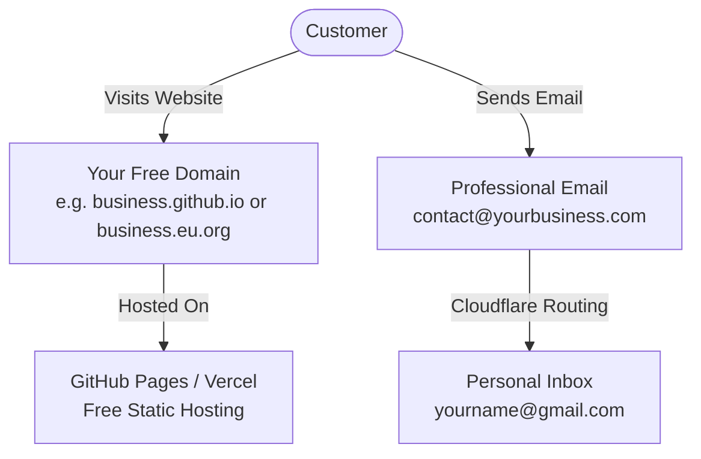

# Comprehensive Guide to Free Domains & Business Setup

Setting up a business website and professional email without spending any money is entirely possible. This guide covers how to register a free domain, host your website for free, and set up a professional business email.

---

## ⚠️ Important Warning About "Free" Domains

When looking for a free domain, you must be careful:
* **Freenom (.tk, .ml, .ga, .cf, .gq) is officially defunct.** These extensions are no longer safely or reliably registrable for free. Avoid any tutorial recommending them.
* **"Forever Free" top-level domains (like `.com`, `.net`, `.org`) do not exist** because ICANN and registries charge annual registration fees. 
* To get a completely free setup, you must use either a **reputable free subdomain** (like `.github.io` or `.vercel.app`) or a **free DNS-enabled domain** (like `.eu.org`).

---

## 🛠️ The Free Business Architecture

Here is how your free business tech stack will work:

---

## Step 1: Get a Free Domain Name

You have two main paths to get a free domain:

### Option A: Free Subdomain (Instant & Highly Reliable)
If you host your site on GitHub Pages or Vercel, you get an instant, free, SSL-secured domain name.
* **Format:** `yourbusiness.github.io` or `yourbusiness.vercel.app`
* **Setup Time:** Instant (5 minutes)
* **Pros:** Highly reliable, fast CDN, auto-configured SSL.
* **Cons:** Includes the host's brand in the URL.

### Option B: Free full domain with DNS Control (EU.org)
`EU.org` has been providing free subdomains since 1996 that behave exactly like normal domains (you get full DNS control to connect to Cloudflare, Zoho, etc.).
* **Format:** `yourbusiness.eu.org`
* **Setup Time:** 2 to 4 weeks (requests are manually approved by volunteers)
* **Pros:** Full DNS/nameserver delegation; you can connect it to custom email hosts.
* **Cons:** Slow approval process; old website interface.

#### How to register an EU.org domain:
1. Go to the official registry website: **[nic.eu.org](https://nic.eu.org/)**.
2. Click on **Register** to create a free user account.
3. Fill out your details (name, email, address) and verify your account via the activation link sent to your email.
4. Log in and click **New Domain**.
5. Enter your desired domain name (e.g., `mycoolcompany.eu.org`).
6. For **Administrative/Technical contacts**, select your own handle.
7. Under **Nameservers**, you must input valid nameservers.
   > [!TIP]
   > Sign up for a free **[Cloudflare](https://www.cloudflare.com/)** or **[ClouDNS](https://www.cloudns.net/)** account to get free nameservers first. Add your desired `eu.org` domain there, get the nameserver addresses (e.g., `ns1.dns.com`), and paste them into the EU.org application form.
8. Submit the form. Once approved, you will receive an email confirmation.

---

## Step 2: Host Your Business Website for Free

You can host modern, fast websites for free using **GitHub Pages** (ideal since you already have a repository structure).

### How to Host on GitHub Pages:
1. **Create a GitHub Account:** Go to [GitHub](https://github.com/) and sign up.
2. **Create a Repository:**
   * Click **New Repository**.
   * Name it `yourusername.github.io` (replace `yourusername` with your actual GitHub username).
   * Set it to **Public**.
   * Check the box to add a **README.md** file.
3. **Upload Your Website Files:**
   * In your repository, click **Add file** -> **Upload files**.
   * Drag and drop your HTML, CSS, and JS files (ensure your home page is named exactly `index.html`).
   * Click **Commit changes**.
4. **Publish Your Site:**
   * Go to the repository **Settings** tab.
   * On the left sidebar, click **Pages**.
   * Under **Build and deployment**, select **Deploy from a branch**.
   * Under **Branch**, select `main` (or `master`) and folder `/ (root)`.
   * Click **Save**.
5. **View Your Site:** After a few minutes, your site will be live at `https://yourusername.github.io`.

---

## Step 3: Set Up a Free Professional Business Email

Once you have your domain (like `yourbusiness.eu.org` or a cheap domain), you can set up a professional email address (e.g., `contact@yourbusiness.eu.org`) and have all messages forwarded to your personal Gmail account.

### How to use Cloudflare Email Routing (100% Free):
1. Sign up for a free account at **[Cloudflare](https://www.cloudflare.com/)**.
2. Add your domain to Cloudflare (e.g., `yourbusiness.eu.org`).
3. Update your domain’s nameservers at your registrar (EU.org) to point to Cloudflare’s nameservers.
4. Once active, go to the **Email** section in your Cloudflare dashboard.
5. Click **Email Routing** -> **Get Started**.
6. Set up your routing rules:
   * **Custom Address:** Enter the email you want users to write to (e.g., `hello@yourbusiness.eu.org`).
   * **Destination Address:** Enter your personal email (e.g., `yourname@gmail.com`).
7. Cloudflare will send a verification email to your personal address. Click the link in that email to confirm.
8. Click **Auto-configure MX records** to let Cloudflare automatically update your domain's DNS records.
9. **Test it:** Send an email from a different account to `hello@yourbusiness.eu.org`. It will arrive instantly in your personal Gmail inbox!

---

## Alternative: How to Send Emails *From* Your Free Business Address
To reply to emails using your business address from your personal Gmail account for free:
1. Go to your Google Account settings -> **Security** -> Enable **2-Step Verification**.
2. Go to **App passwords** (search for it in the settings search bar).
3. Generate a new app password for "Mail" and name it "Gmail Custom Send". Copy the 16-character password code.
4. Open Gmail -> Click the **Gear Icon (Settings)** -> **See all settings** -> **Accounts and Import** tab.
5. In the **Send mail as** section, click **Add another email address**.
6. Enter your business name and your business email address (e.g., `hello@yourbusiness.eu.org`). Ensure "Treat as an alias" is checked. Click Next.
7. Set the SMTP Server to `smtp.gmail.com` and Port to `587`.
8. For **Username**, enter your full personal Gmail address (e.g., `yourname@gmail.com`).
9. For **Password**, paste the 16-character app password you generated earlier.
10. Select **Secured connection using TLS** and click **Add Account**.
11. Gmail will send a confirmation code to your business email (which gets routed to your inbox). Enter the code to verify.
12. Now, you can send and reply to emails from Gmail using your business email address!
